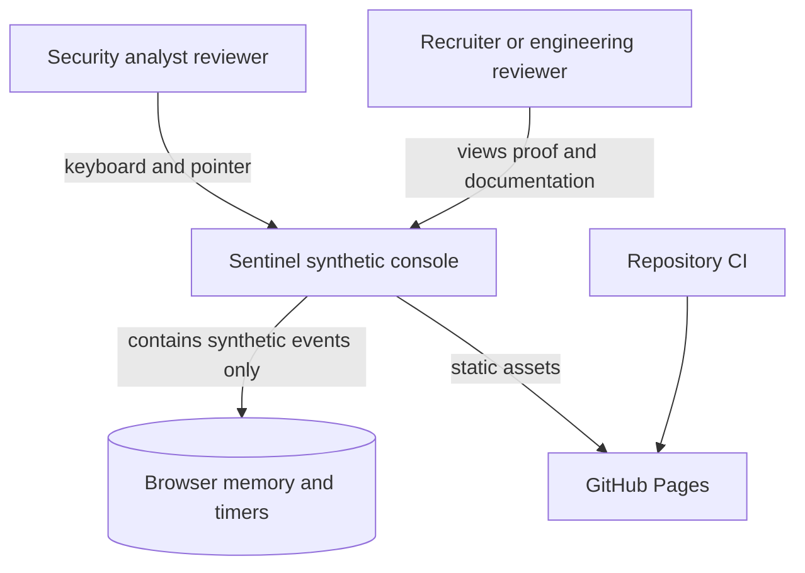
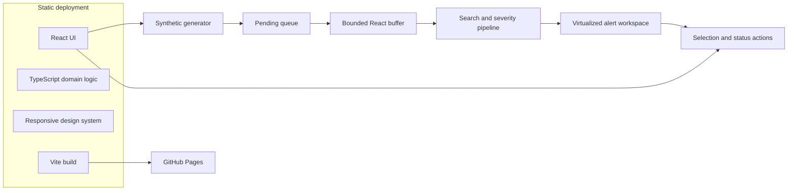
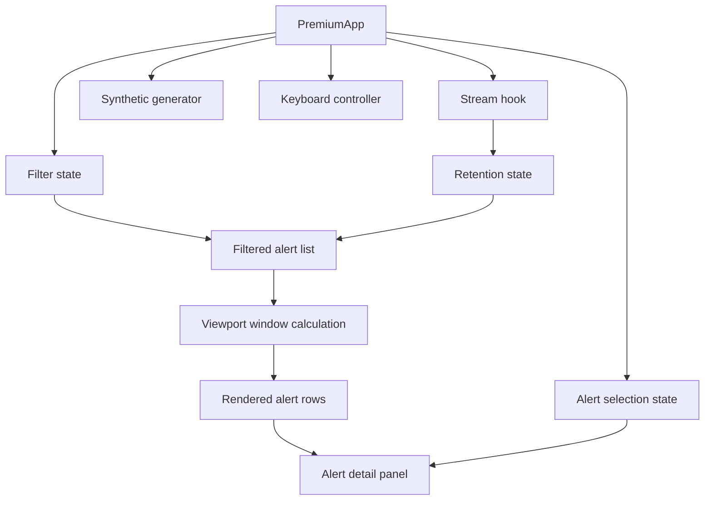
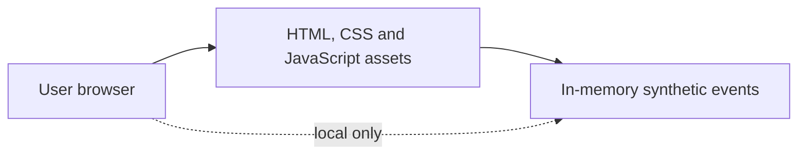

# C4 and Architecture Views

## Level 1: System context

## Level 2: Container view

## Level 3: Component view

## Physical view

There is intentionally no API, database, identity provider, secrets store, network event transport, or production telemetry connection in this proof.
