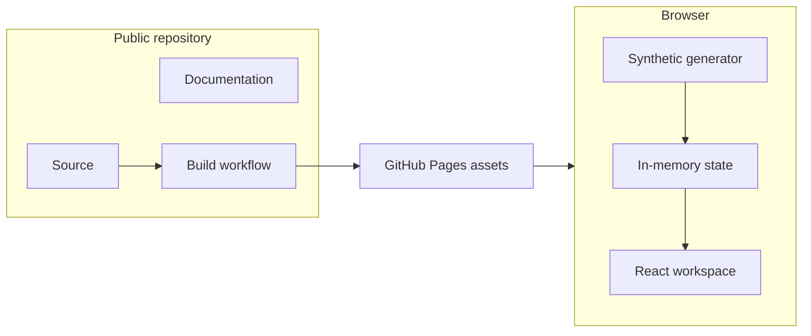

# Data Flows and Trust Boundaries

## Production boundary

The only externally deployed components are static application assets. Browser state and synthetic generation remain local to the user device.

## Trust levels

1. Repository source: maintainers' authored code.
2. Dependencies: pinned third-party supply-chain inputs.
3. Synthetic values: locally generated, untrusted and rendered as text.
4. User input: search text, filters, status actions, and keyboard commands.
5. Browser storage: none is required by the current proof.

## Input paths

- Synthetic generator output is not considered trusted solely because it is local.
- Search strings are applied to normalized text without HTML interpretation.
- Status actions target synthetic IDs from the current selection.
- URL parameters, if later added, require validation before use.

## Privacy boundary

- No IP, account, cloud credential, cookies, telemetry, session recording, or production indicator is required.
- Synthetic indicators should remain visibly synthetic.
- Browser analytics require a separate privacy decision and threat review.
