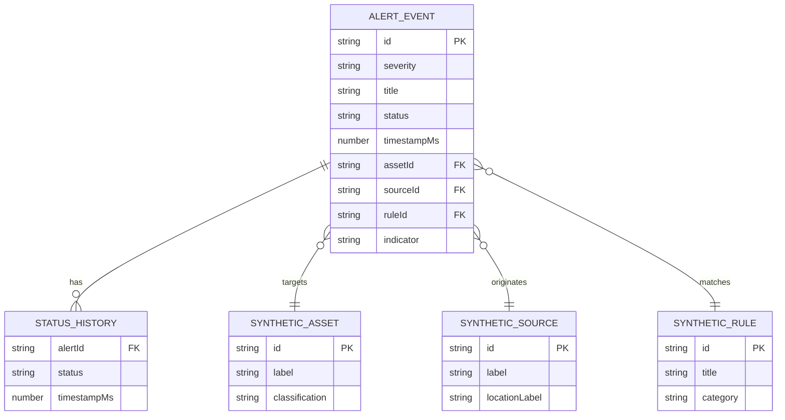

# Data Model and Schema

## Entity relationship diagram

## Ownership and retention

- Synthetic values are owned by the browser generator.
- Alert status is owned by UI triage state in the browser session.
- Status history is not persisted in the current proof unless separately implemented.
- Retention is bounded by the stream capacity.
- Refreshing the page resets synthetic state.

## PII and sensitivity classification

| Field group | Classification | Handling |
|---|---|---|
| Synthetic asset IDs | Synthetic/public demo | Prefix `SYN-` |
| Synthetic source IDs | Synthetic/public demo | Prefix `SYN-` |
| Synthetic indicator values | Synthetic/public demo | Must not resolve to real infrastructure |
| User-entered text | User-provided | Not sent externally or persisted |
| Status state | Low sensitivity demo | Browser memory only |

## Integrity rules

- ID is immutable and unique in the retained collection.
- Severity must be one of documented enum values.
- Status must be one of documented enum values.
- Timestamp must be a valid millisecond epoch.
- Related synthetic IDs must follow synthetic policy.
- Status changes must not mutate the alert identifier.

## Versioning

Event shape changes require data-contract updates, fixtures, migration guidance if persisted, and backward compatibility decisions.
