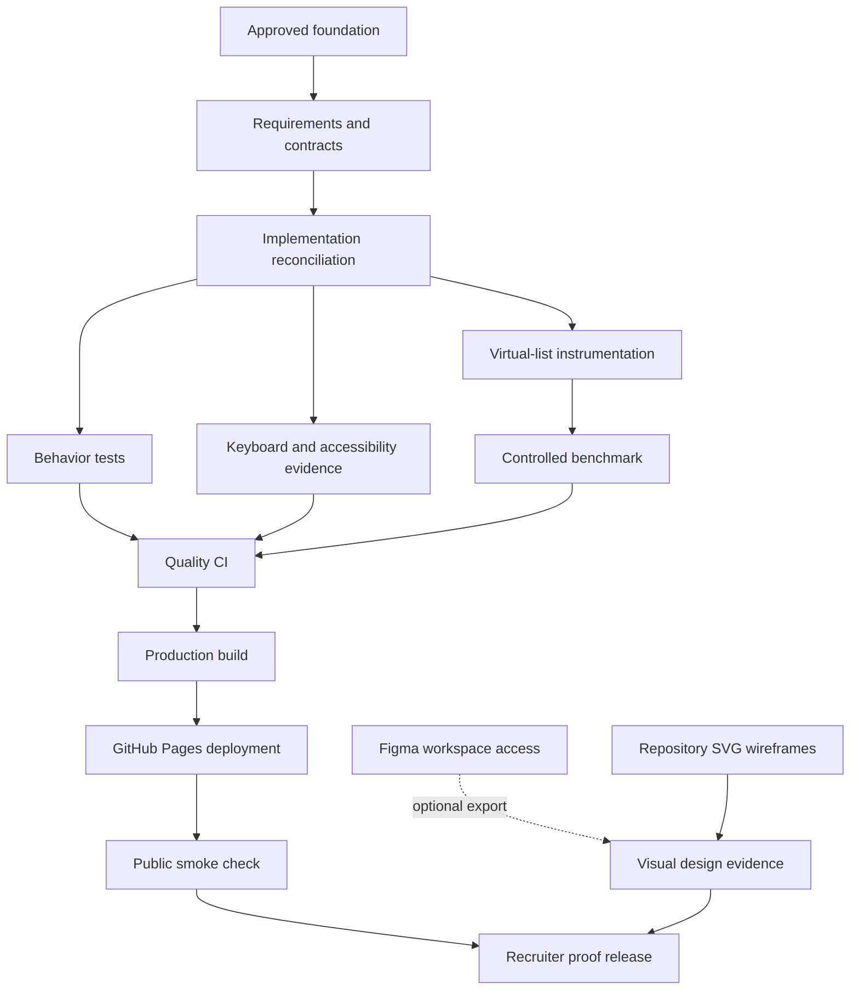

# Delivery Dependency Map

## Critical path

1. Reconciliation.
2. Tests.
3. Accessibility and virtualization evidence.
4. Controlled benchmark.
5. CI/build/deployment.
6. Release checklist.

## Parallel work

- Repository wireframes and design system.
- Operations and deployment documentation.
- Repository governance and dependency policy.
- External Figma export where access is available.

No visual proof should be published ahead of implementation reconciliation.
