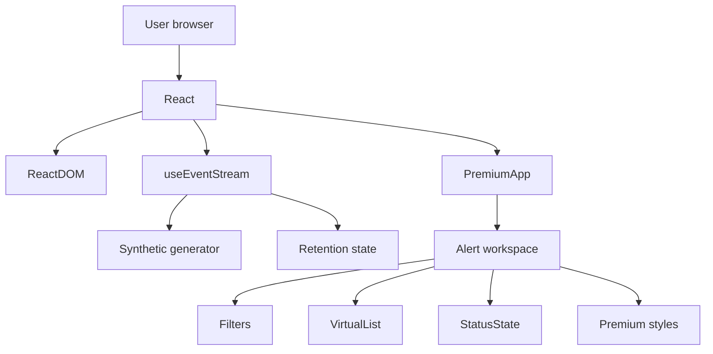
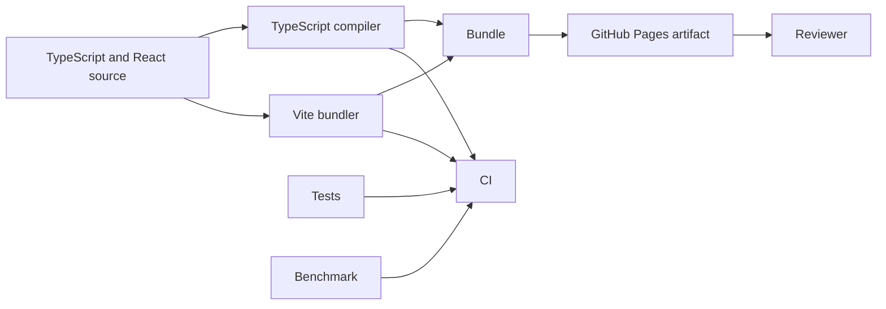

# Dependency Graph

## Runtime dependency graph

## Tool dependency graph

## External services

The current runtime has no required API service or database. GitHub and GitHub Actions are delivery dependencies, not application runtime dependencies.

## Dependency control

- Lockfile must be committed.
- Package additions require purpose, maintenance, license, bundle, security, and alternatives review.
- Latest or floating package versions should be replaced by reproducible pins before release evidence.
- GitHub Actions should use reviewed or pinned references.
