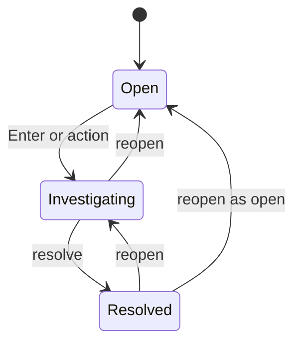
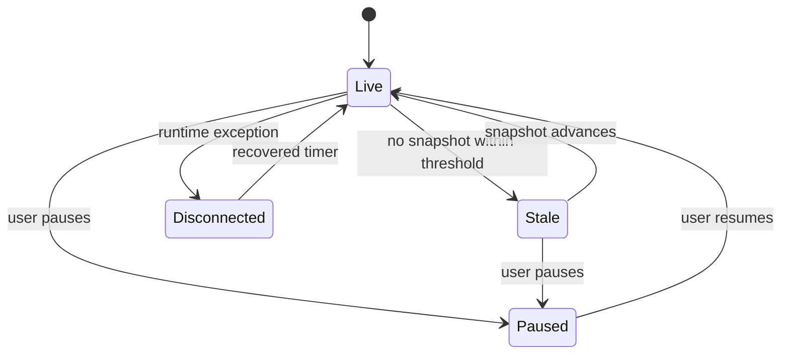
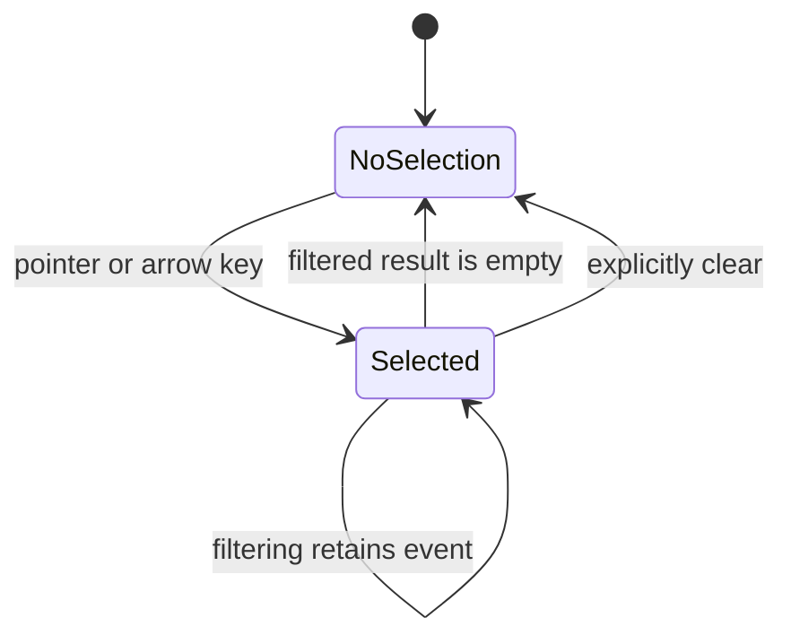

# State Machines

## Alert investigation state

## Invariants

- Every alert has exactly one status.
- Status changes are local and identity-addressed.
- Filtering must not duplicate or remove an alert object.
- React keys use the synthetic event ID.

## Stream state

## State activation rule

Until stale/disconnected transitions are implemented and tested, do not present them as production-ready features. This document distinguishes required design from existing UI behavior.

## Selection state

When a selection is removed, choose a deterministic fallback or keep no selection and announce why.
