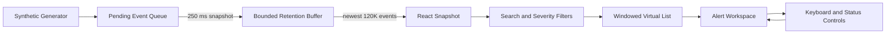
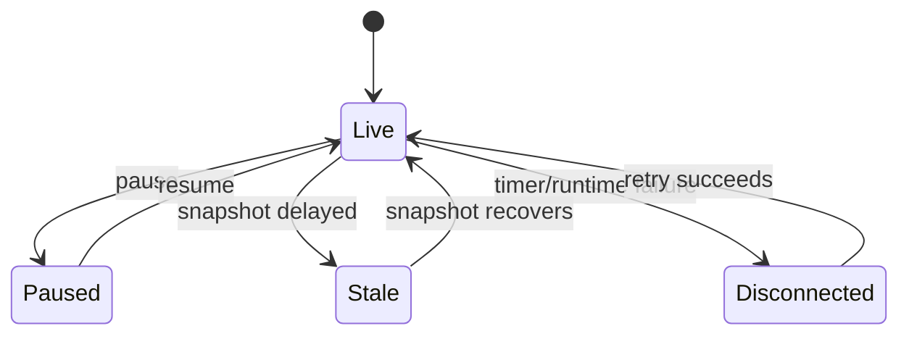
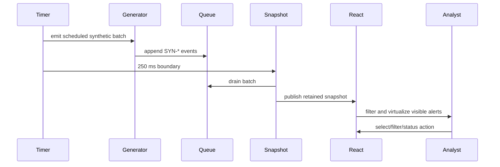
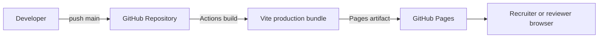

# System Design

## Design summary

Sentinel is a browser-only synthetic security operations console. It turns synthetic telemetry into bounded alert snapshots, then provides a keyboard-accessible investigation workspace. Its critical engineering properties are bounded memory, predictable rendering, explicit synthetic status, and reconciliation between documented targets and deployed behavior.

## Goals

- Sustain synthetic ingest at configurable rates.
- Preserve newest alert evidence within a fixed capacity.
- Prevent per-event React commits.
- Render the visible alert slice rather than the complete dataset.
- Preserve keyboard focus and selection.
- Keep synthetic privacy and data provenance explicit.

## Non-goals

- Detecting real threats.
- Connecting to customer systems, SIEMs, EDRs, or cloud tenants.
- Distributed event delivery, durable storage, authentication, or multi-user collaboration.
- Production-grade SLO measurement from synthetic browser workload.

## Logical architecture

## Runtime components

| Component | Responsibility | Current boundary |
|---|---|---|
| Generator | Creates synthetic alerts and related entities | Browser timer |
| Producer queue | Coalesces generated work | In-memory array |
| Snapshot loop | Publishes bounded React updates every 250 ms | Browser interval |
| Retention buffer | Keeps newest capacity events | React state slice |
| Filter pipeline | Applies text and severity predicates | Browser render path |
| Virtual list | Computes visible rows | Browser layout state |
| Triage state | Holds selection, status, expanded alert, and filters | React local state |
| Static delivery | Builds and serves the deployed site | GitHub Pages |

## State model

A public display of Degraded, Stale, or Disconnected status is only valid when the runtime implements and tests that state transition.

## Event lifecycle

## Capacity model

- Generator default: 240 synthetic events per second.
- Timer batch: approximately 60 events every 250 ms.
- Snapshot interval: 250 ms.
- Retained capacity: 120,000 alert objects.
- UI should mount only rows intersecting the viewport and overscan window.

The actual runtime should be measured and documented before a capacity or throughput claim is presented as production-like.

## Rendering model

The list calculates row offset from a fixed row height. Scroll position maps to an estimated start index. Search and severity results are filtered before windowing. Selection, status, and focus changes must not invalidate the synthetic identity of the selected alert.

## Error and recovery behavior

- Empty pending queue: no snapshot commit.
- Burst: queue grows without blocking UI rendering, subject to browser limits.
- Invalid synthetic value: substitute a documented safe synthetic value; never pass raw HTML.
- Timer failure: surface disconnected state if instrumentation exists.
- Focus lost after filtering: restore focus to a stable workspace target and preserve selection rules.
- Deployment asset failure: run the deployment smoke check before release.

## Deployment architecture

## Security boundary

The application has no credentials or backend. Synthetic identifiers and values are generated locally. Public documentation and deployed bundles must not contain employer, customer, production, credential, or personal telemetry.

## Open implementation reconciliation

Before every public architecture claim, reconcile:

1. Generator and queue behavior.
2. Actual snapshot and eviction code.
3. Mount count and virtual-list instrumentation.
4. Status-state transitions.
5. Benchmark and error handling.
6. Accessibility behavior.
7. Static deployment assets.
