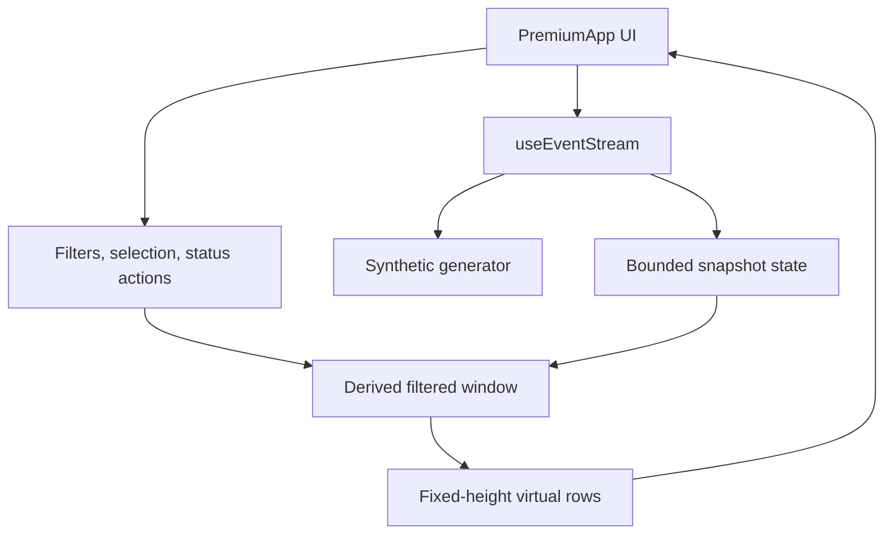

# Technical Design Document

## Decision summary

Sentinel is a single-page React application. Synthetic generation, bounded retention, filtering, virtualization, and triage state remain in the browser. GitHub Pages provides static hosting only.

## Requirements traceability

| Requirement | Component | Verification |
|---|---|---|
| Synthetic configurable stream | useEventStream, synthetic | unit and browser tests |
| Bound retention | stream buffer/state | unit capacity tests |
| Batched snapshot | stream hook | cadence instrumentation |
| Virtual list | workspace list | row mount count test |
| Keyboard triage | workspace controller | keyboard automation/manual |
| Status actions | workspace state | component tests |
| Synthetic provenance | generator, UI badge | data-policy review |
| Deployment | GitHub Actions | deployed URL smoke check |

## Runtime layering

## Module boundaries

### Synthetic generator

Inputs are rate and optional seeded sequence state. It creates synthetic alert objects with valid enums and explicit `SYN-` identity.

### Stream hook

Owns timers, pending queue, snapshot cadence, active state, retained collection, and cleanup. Timer callback behavior must be testable independently where practical.

### Workspace controller

Owns selection, filters, status transitions, scroll position, and focus behavior. It must not mutate source data.

### Virtual list

Computes start/end indexes from fixed row height and scroll offset, then renders only its window plus bounded overscan. Selection and status must survive virtualization.

## Data ownership

| Data | Owner | Lifetime | Persistence |
|---|---|---|---|
| Synthetic alerts | stream hook | browser session | memory |
| Filter input | workspace | browser session | memory |
| Selection | workspace | browser session | memory |
| Status mutation | workspace | browser session | memory |
| User settings | none currently | none | none |

## Concurrency and React behavior

- Producer and snapshot intervals are independent.
- Snapshot commits do not occur for an empty pending queue.
- The newest events are prepended, with oldest trimming.
- Status mutations should update an immutable snapshot entry by identity.
- StrictMode timer setup must clean up without duplicated intervals.

## Error boundaries

- Generator failures must not prevent static UI rendering.
- Invalid synthetic fields are normalized or filtered according to contract.
- Rendering exceptions should remain recoverable through a documented error boundary.
- Accessibility instrumentation should not block alert rendering.

## Scalability limits

Browser memory and JavaScript execution are the capacity boundary. Scaling into a backend would require separately documented transport, schema, delivery, replay, retention, partitioning, and observability designs.

## Deployment

Vite creates a static bundle. GitHub Actions checks out the commit, installs dependencies, runs quality gates, builds, uploads artifact, and deploys to GitHub Pages. Asset URLs must respect the repository base path.

## Trade-offs

### Browser-only vs backend

Benefits include zero operational credentials and immediate demo. Costs include no real-time distributed transport, persistence, authentication, or cross-device consistency.

### Bounded array vs ring buffer

A bounded array is easy to understand and test; a dedicated ring-buffer type may improve write behavior at scale. The implementation decision is constrained by measured behavior and must match ADR 001.

### Custom virtual list vs library

Custom fixed-height code reduces dependency size and exposes engineering behavior but increases maintenance and accessibility risk. The accepted windowing contract determines which approach is valid.
