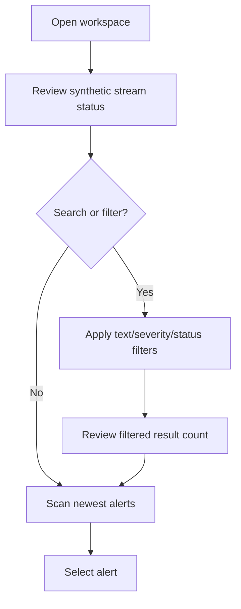
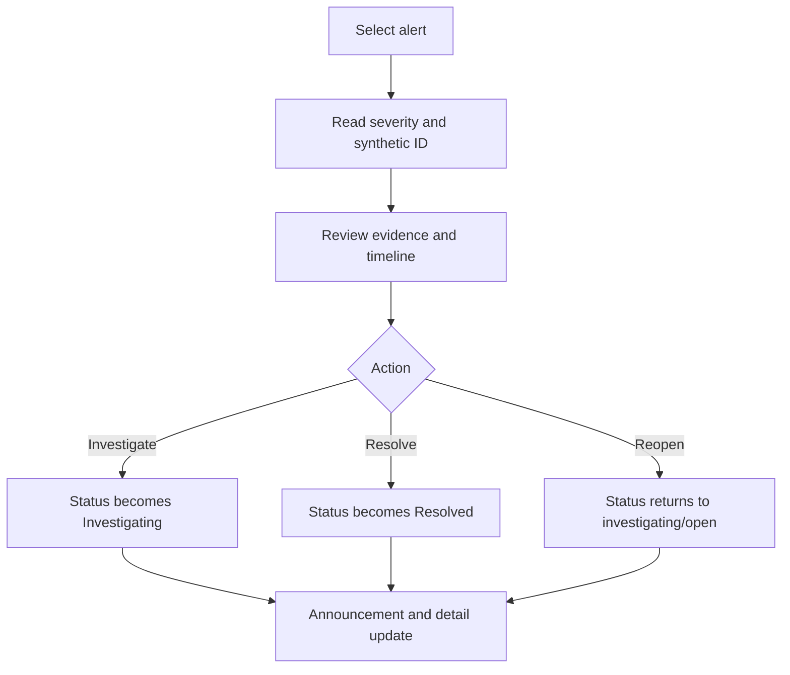

# UX Flows

## Flow 1: Scan and filter alerts

## Flow 2: Investigate alert

## Flow 3: Keyboard-only triage

1. Tab to the workspace.
2. Use Arrow Up/Arrow Down to change selection.
3. The list scrolls the selection into view.
4. Enter changes the selected alert to Investigating according to the keyboard contract.
5. Tab to status actions.
6. Activate resolve/reopen.
7. Press Escape according to the documented close/focus behavior.

## Flow 4: Stream pause

1. Tab to pause control.
2. Activate control once.
3. Stream status visibly and accessibly changes to Paused.
4. Existing synthetic alerts remain available and can be triaged.
5. Activate resume control to restore generation.

## Flow 5: Empty filtered result

1. User applies incompatible filters.
2. UI shows a clear empty state.
3. Selection is cleared or moved deterministically.
4. User clears search/filter with visible control.
5. Workspace returns to a stable alert row and focus target.
